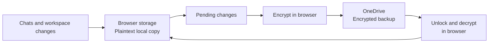

# How backup works

Wingman saves your work in the browser first. When online backup is enabled by
the deployment and you configure a PIN or passkey, it also uploads encrypted
copies to OneDrive. You can continue working offline.



## Choose a provider

The default provider is `local`, which uses the existing ZIP download and restore
controls. Omitting the provider or using `"backup": {}` selects local backups.

```json
{
  "backup": {
    "provider": "local"
  }
}
```

For online backups, set the `backup` section in `config.json`:

```json
{
  "backup": {
    "provider": "onedrive",
    "drive": "onedrive"
  }
}
```

`drive` references the connection's id in `drives.yaml` and can be omitted when
there is exactly one OneDrive connection. The providers are `local` (ZIP files) and
`onedrive` (encrypted OneDrive storage). The backend reads the first existing file in this order: `config.json`
in its working directory, `public/config.json` for local development, then
`dist/config.json` for built assets. Only the `backup` section is read by the
backend; other browser settings keep their existing behavior. In Docker, mount
`config.json` at `/app/config.json` (the image build resets the bundled browser
configuration). Restart the backend after changing it.

Alternatively, configure `backup.yaml` using the existing OneDrive connection:

```yaml
provider: onedrive
drive: onedrive # The connection's id in drives.yaml
```

The backend exposes this as `backup: { provider: "onedrive", drive: "onedrive" }`
in `/config.json`; `onedrive` enables online backup controls, while
`local` keeps the ZIP backup controls. `drive` may be
omitted when exactly one OneDrive connection exists. Unknown providers or missing
or ambiguous connections fail startup. When both are present, `backup.yaml`
overrides JSON. Environment overrides `BACKUP_PROVIDER` and `BACKUP_DRIVE` take
precedence over both. Restart the backend after changing configuration.

The JSON file must also be available to the chat backend; a frontend-only dev server cannot change a separately deployed
backend’s provider. Switching providers selects a separate backup;
it does not migrate or delete the old destination. Configure protection at the new
destination before local data can upload there. The browser detects a changed
OneDrive destination using the backend’s account endpoint, preserves local content,
clears the previous destination’s sync tracking, and reloads open tabs. Finish any
pending remote reset before switching providers; it will not be replayed against
the new destination.

### Stable account identity

For Microsoft Entra authentication, the chat backend reads `tid` and `oid` from
`X-Forwarded-Access-Token` and uses the lowercase `<tid>:<oid>` pair as the storage
identity. `/api/v1/me` returns its truncated SHA-256 hash for encryption context
and browser sync state. Email is display information and can change without
changing that identity. A new tenant or a recreated account selects a different
backup.

The authenticated OAuth2 Proxy must forward the access token:

```yaml
environment:
  OAUTH2_PROXY_PASS_ACCESS_TOKEN: "true"
  OAUTH2_PROXY_PASS_USER_HEADERS: "true"
```

The backend decodes these claims; it does not independently verify JWT signatures.
The proxy must validate the session, strip/overwrite client-supplied authentication
headers, and be the only route to the backend. A client `Authorization` header is
not used to select the user. Malformed forwarded tokens or present but invalid
Entra claims fail with 401 instead of falling back to an email namespace. When no
forwarded token exists, or a valid token has no Entra identity fields, existing
trusted user/email headers remain available for development and other providers.

On the first upgrade from an email-based identity, keep the proxy’s existing user
header mapping. `/api/v1/me` includes a `previousId` hint derived from that trusted
header. Browsers with matching old ownership markers preserve local chats and
files, discard the old sync baselines and remembered keys, then reload before
starting engines for the stable identity. Choose PIN/passkey protection again to
upload that local copy into the new namespace. A subsequent email change leaves
the stable identity and its keys unchanged.

Existing ciphertext is not automatically re-encrypted for a changed identity.
Before upgrading an email-based OneDrive deployment, export the old backup while
it can still be unlocked. After upgrading, reset the online backup, restore that
export locally, and configure protection again. The OneDrive folder belongs to
the delegated Microsoft account; changing the app’s encryption identity alone
does not select a new folder. Finish pending remote resets before upgrading.

### OneDrive authentication and storage

The OneDrive provider uses the same forwarded access token and optional
on-behalf-of exchange as the selected reader connection. The reverse proxy must
supply `Authorization: Bearer …` or `X-Forwarded-Access-Token` on backup API requests,
alongside the existing trusted account identity headers. The resulting token must
be for Microsoft Graph and have delegated write access: `Files.ReadWrite.All`
already suffices, or use `Files.ReadWrite.AppFolder` for app-folder-only access.
Keep broader read permissions if the file browser needs to browse outside the app
folder. Re-consent after changing permissions. No additional Microsoft login or
refresh-token store is introduced by this provider. A personal Microsoft account
requires a compatible existing Graph token flow; this feature does not add a
personal-account sign-in flow to an organizational OBO deployment.

Backups live under `Apps/<Microsoft app name>/backup/`. The exact app-folder name
comes from the registration that issued the Graph token. Each Microsoft account
has its own OneDrive. Data and
protected recovery keys are encrypted in the browser before upload. OneDrive sees
opaque objects and a metadata index containing sizes, resource IDs and timing.

Chat appends upload immutable event segments; changed workspace files and blobs
upload separately. An index publishes committed versions only after their objects
are uploaded. Failed writes remain pending in the browser. File and blob uploads use temporary
encrypted files on the chat backend, removed when the request finishes, to bound
memory. Chat appends encode one incoming batch in memory before uploading it. The backend
rejects file and blob bodies over 257 MiB and append bodies over 64 MiB with 413;
the browser splits large chat uploads into several appends below that cap. Files larger than 10 MiB use upload sessions with sequential 10 MiB
fragments. Throttled requests retry with bounded backoff; interrupted operations
retry through the existing sync loop. Sessions are not persisted across requests.

OneDrive uses conditional index writes with Microsoft Graph ETags to coordinate
requests across replicas. Before its first commit for an account folder, each
backend verifies that isolated probe writes reject both duplicate creation and
stale ETags; it refuses index writes if either check fails. Unrelated resource
changes merge and retry; concurrent
changes to the same resource return a conflict. A changed keystore or reset
generation rejects uploads that started before that change. No lock files, persistent volume, or shared
filesystem are required. Encrypted upload
spools use the backend's temporary directory and are removed after each request.

Usage reports OneDrive's account-folder size, which may update with a delay.
Old objects are reclaimed after a successful replacement; cleanup failures and
uncertain commits may leave unreferenced objects that still consume quota.
Reset also works when the index contents are corrupt or unsupported. It atomically clears the index and its key material, retaining an empty index
with a fresh generation to fence stale writers. It then deletes a snapshot of
existing encrypted objects, including objects left by earlier failed commits.
An upload already in progress can leave an unpublished object after reset; it
cannot publish into the new backup. An old device that starts a request after
reset and re-enrollment is not fenced by this mechanism. Cleanup failures can be retried with another
reset. Concurrent deletion or reset can interrupt a download; restore reports the
failure and must be retried rather than accepting a partial backup. OneDrive's recycle
bin and version-history policies still apply: a reset or PIN change cannot revoke
historical copies already retained by OneDrive. Restoring backups uses Wingman's
restore controls, rather than manually reverting individual OneDrive objects.

## When does it sync?

| Trigger                           | What happens                                                                                                             |
| --------------------------------- | ------------------------------------------------------------------------------------------------------------------------ |
| Edit a chat                       | Save locally through the persistence queue, normally within 100 ms; then attempt an upload.                              |
| An AI response is running         | Continue local saves. Pause that chat's uploads and this page's workspace file uploads. Already-sent uploads can finish. |
| Request finishes, stops, or fails | Flush local saves, then resume uploads. Large chats may need several frames.                                             |
| Change a workspace file           | Normally upload after a 2-second debounce.                                                                               |
| Open the app                      | Reconcile local files and retry pending chat uploads. Unlocked sessions also pull remote chats.                          |
| Keep the tab visible              | Pull chats and retry pending chat uploads every minute; reconcile files about every five minutes.                        |
| Return to the tab                 | Pull chats and retry pending chat uploads immediately; reconcile files if due.                                           |
| Select **Sync now**               | Pull chats, upload pending chats, and reconcile files. Request pauses still apply.                                       |

Failed uploads remain pending for retry. Incoming sync requires unlocked backup access.
Open tabs share the local mirror: each chat syncs under a cross-tab lock and
starts from the baseline last written by any tab, so events are never applied twice.
Store requests time out after a minute (ten for file and attachment transfers).

## Where is data stored?

**In the browser:** chats and workspace files live in OPFS (Origin Private File
System), in plaintext. Pending changes survive reloads. Local data remains
accessible when online backup is locked or offline.

**In OneDrive:** encrypted backup objects and the index live in the app folder.
Chats use encrypted event segments; attachments and workspace files are separate
encrypted objects. Paths stay inside the encrypted payload. The backend can see
account identity, resource IDs, sizes, and update timing.

## How is it encrypted?

Encryption happens **in the browser before upload**; decryption happens there
after download. Each new event frame, attachment, or file gets a fresh random
AES-256-GCM key and nonce. RSA-OAEP-SHA256 (3072-bit) wraps that content key.
Authenticated context binds the payload to its account, resource, and key ID.
This protects confidentiality, not authorship: the public key is known to the
backend, so a compromised backend could create payloads that decrypt correctly.
Restored workspace files must still match the resource ID derived from their path.

The server holds the RSA private key encrypted under a random root key. Your PIN
or passkey (WebAuthn PRF + HKDF-SHA256) protects that root key. Either configured
method can unlock it. Changing protection preserves existing data and keys; older
symmetric backups remain readable.

New PINs must have at least 8 characters. They are stretched with Argon2id
(64 MiB, 3 passes) and HKDF-SHA256. A leaked keystore permits offline PIN
attempts; Argon2id raises the cost of each guess. Older PBKDF2-SHA256 PINs are
re-wrapped after a successful unlock. Existing short PINs continue to work.

Backups created by an earlier experimental version with a PIN pepper require
migration: unlock with a passkey or the previous version and restore/export the data,
then reset and configure a new backup. A configured passkey can also continue
to unlock the existing backup, but its old peppered PIN will no longer work.
Without the old server secret, a passkey, an unlocked device, or an export,
a peppered PIN backup cannot be recovered.

Setup and unlock automatically remember this device. The root key is saved in
local IndexedDB as a non-extractable Web Crypto key, excluded from exports. Scripts
running in the page can use it while the app is open, but cannot read or copy its
bytes. Access to the browser profile still grants local data and remembered backup
access. Because the saved key cannot be read back, adding or replacing a recovery
method on a remembered device first asks for an existing method again: a passkey
prompt, or the PIN before adding a passkey. A cached public key supports
upload-only operation; restoring or reconciling conflicts requires unlocking.

## What is included?

Online backup covers chats, referenced attachments, current artifacts and app
state, projects, drafts, agents, skills, plugins, images, memory, and the profile.
It excludes internal sync tracking, local artifact revision history, browser
preferences and OAuth credentials in localStorage, and remembered-device keys.
Workspace files larger than 256 MiB stay local and remain pending with an explicit size-limit error.

## Restore, conflicts, and reset

On a new browser, sign in and choose **Restore backup**, then use your PIN or
passkey. There is no automatic recovery if you lose both methods and all unlocked
devices. Passkeys require a compatible provider and the same site hostname.

Sync is not collaborative editing: concurrent chat changes can overwrite each
other; ordinary file conflicts use modification times. Remote deletion removes
unchanged local copies, while pending local edits survive and can upload again.
Pending chat deletions use a separate per-chat local journal so simultaneous
offline deletions in different tabs cannot overwrite each other.

**Deactivate backup** removes this browser's remembered keys and stops sync across
its open tabs, retaining local data and the online copy. **Reset online backup**
deletes the selected destination’s data and protection settings, retaining local data. Backups
remain off until you configure protection again.

For implementation and deployment details, see [Persistence contracts](persistence.md).

## Provider interface

`store.Provider` remains the extension point for future backup destinations.
OneDrive is the only online implementation. The interface has 14 methods covering keystore CAS,
chat events and compaction, encrypted objects, file listing, attachment existence,
usage, and reset. Files and blobs share `GetObject`, `PutObject`, and `DeleteObject`,
with `ObjectKind` keeping their namespaces separate. Conditional object writes
return `ErrObjectConflict` when their ETag precondition fails.
Each method serves an existing API operation; providers own concurrency control
and must fence requests that began before a reset or keystore change. Local ZIP export stays in the browser.

Chat attachments are content-addressed and may be shared across conversations.
Deleting a chat removes its event history but retains shared encrypted attachment
objects until account reset. This avoids deleting another chat's attachments;
retained objects continue to count toward OneDrive usage.
