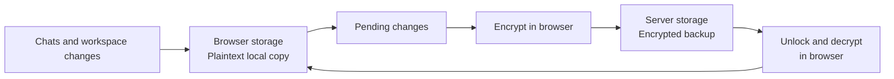

# How backup works

Wingman saves your work in the browser first. When online backup is enabled by
the deployment and you configure a PIN or passkey, it also uploads encrypted
copies to the server. You can continue working offline.

## When does it sync?

| Trigger | What happens |
| --- | --- |
| Edit a chat | Save locally through the persistence queue, normally within 100 ms; then attempt an upload. |
| An AI response is running | Continue local saves. Pause that chat's uploads and this page's workspace file uploads. Already-sent uploads can finish. |
| Request finishes, stops, or fails | Flush local saves, then resume uploads. Large chats may need several frames. |
| Change a workspace file | Normally upload after a 2-second debounce. |
| Open the app | Reconcile local files and retry pending chat uploads. Unlocked sessions also pull remote chats. |
| Keep the tab visible | Pull chats and retry pending chat uploads every minute; reconcile files about every five minutes. |
| Return to the tab | Pull chats and retry pending chat uploads immediately; reconcile files if due. |
| Select **Sync now** | Pull chats, upload pending chats, and reconcile files. Request pauses still apply. |

Failed uploads remain pending for retry. Incoming sync requires unlocked backup access.

## Where is data stored?

**In the browser:** chats and workspace files live in OPFS (Origin Private File
System), in plaintext. Pending changes survive reloads. Local data remains
accessible when online backup is locked or offline.

**On the server:** data lives under `BACKUP_STORE_PATH`, separated by account.
Chats use encrypted event logs with sequence and deduplication metadata;
attachments are separate encrypted blobs. Workspace files use encrypted objects
and an atomic manifest that publishes their current versions. File paths travel
inside the encrypted payload; file IDs are hashes of paths. The server can still
see account identity, resource IDs, sizes, and update timing.

## How is it encrypted?

Encryption happens **in the browser before upload**; decryption happens there
after download. Each new event frame, attachment, or file gets a fresh random
AES-256-GCM key and nonce. RSA-OAEP-SHA256 (3072-bit) wraps that content key.
Authenticated context binds the payload to its account, resource, and key ID.

The server holds the RSA private key encrypted under a random root key. Your PIN
(PBKDF2-SHA256, 600,000 iterations) or passkey (WebAuthn PRF + HKDF-SHA256) protects
that root key. Either configured method can unlock it. Changing protection
preserves existing data and keys; older symmetric backups remain readable.

Setup and unlock automatically remember this device: the root key is saved in
local IndexedDB, excluded from exports. Access to the browser profile grants local
data and remembered backup access. A cached public key supports upload-only
operation; restoring or reconciling conflicts requires unlocking.

## What is included?

Online backup covers chats, referenced attachments, current artifacts and app
state, projects, drafts, agents, skills, plugins, images, memory, and the profile.
It excludes internal sync tracking, local artifact revision history, browser
preferences and OAuth credentials in localStorage, and remembered-device keys.
Workspace files larger than 256 MiB stay local.

## Restore, conflicts, and reset

On a new browser, sign in and choose **Restore backup**, then use your PIN or
passkey. There is no automatic recovery if you lose both methods and all unlocked
devices. Passkeys require a compatible provider and the same site hostname.

Sync is not collaborative editing: concurrent chat changes can overwrite each
other; ordinary file conflicts use modification times. Remote deletion removes
unchanged local copies, while pending local edits survive and can upload again.

**Deactivate backup** removes this browser's remembered keys and stops sync across
its open tabs, retaining local data and the online copy. **Reset online backup**
deletes the server data and protection settings, retaining local data. Backups
remain off until you configure protection again.

For implementation and deployment details, see [Persistence contracts](persistence.md).
