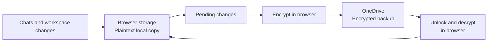

# How backup works

Wingman saves your work in the browser first. When online backup is enabled by
the deployment and you configure a PIN or passkey, it also uploads encrypted
copies to OneDrive. You can continue working offline.



## Choose a provider

The default provider is `local`, which uses ZIP download and restore controls.
These controls also remain available when online backup is enabled. Omitting the
provider selects local backups.

For online backups in Kubernetes, add one environment variable to the Wingman
container:

```yaml
env:
  - name: BACKUP_PROVIDER
    value: "onedrive"
```

Without further configuration, backup uses the forwarded Microsoft Graph token
directly. To exchange the incoming token on behalf of the user, configure `auth`
in `backup.yaml`:

```yaml
provider: onedrive
uploads: 4 # optional: concurrent uploads per backend pod
auth: # optional: On-Behalf-Of exchange
  issuer: https://login.microsoftonline.com/${AZURE_TENANT_ID}/v2.0
  client_id: ${AZURE_CLIENT_ID}
  client_secret: ${AZURE_CLIENT_SECRET}
  scope: Files.ReadWrite.AppFolder
```

Backup configuration is independent of `drives.yaml`: file-browser connections
and backup can use different app registrations and scopes. The `auth` fields
support `$VAR` and `${VAR}` references, and an empty scope defaults to
`https://graph.microsoft.com/.default`.

The providers are `local` (ZIP files) and `onedrive` (encrypted OneDrive
storage). The backend exposes the choice as `backup: { provider: "onedrive" }` in
`/config.json`; `onedrive` enables online backup controls, while `local` keeps
the ZIP backup controls. Unknown providers or invalid `auth` settings
fail startup. `BACKUP_PROVIDER` and `BACKUP_UPLOADS` take
precedence over `backup.yaml`. Restart the backend after changing configuration.

Switching providers or Microsoft accounts selects a separate backup; it does
not migrate or delete the old one. Each browser records which backup its local
sync tracking belongs to (the keystore's account ID). When it finds a different
or missing backup, it clears that tracking and reloads open tabs, keeping local
chats and files; they upload again once protection is configured at the new
destination.

### Stable account identity

The chat backend identifies the backup user by the proxy's `X-Forwarded-User`
header. `/me` returns its truncated SHA-256 hash, which the browser uses
to tell apart accounts' local sync state. Backup API requests without `X-Forwarded-User`
fail with 401. Which backup is used is decided by the Microsoft account behind
the Graph token, not by this header.

Ciphertext is bound to a random `accountId` stored in the keystore, not to the
sign-in identity, so a changed header value does not make an existing backup
unreadable. The server rejects keystores without a valid `accountId` and
updates that change it.

Still prefer a stable subject over an email address for `X-Forwarded-User`
(OAuth2 Proxy forwards the OIDC `sub` claim by default): a browser treats a new
value as a different account and asks to export and clear its local workspace
before syncing again.

```yaml
environment:
  OAUTH2_PROXY_PASS_ACCESS_TOKEN: "true"
  OAUTH2_PROXY_PASS_USER_HEADERS: "true"
```

The backend trusts these headers and does not authenticate requests itself. The
proxy must validate the session, strip/overwrite client-supplied `X-Forwarded-*`
headers, and be the only route to the backend. The forwarded Microsoft token, not
`X-Forwarded-User`, selects the OneDrive backup.

### OneDrive authentication and storage

The OneDrive provider uses the forwarded access token, optionally exchanged
on-behalf-of the user with the `auth` settings in `backup.yaml`. The reverse proxy must
supply `Authorization: Bearer …` or `X-Forwarded-Access-Token` on backup API requests,
alongside the existing trusted account identity headers. The resulting token must
be for Microsoft Graph and have delegated write access: `Files.ReadWrite.All`
already suffices, or use `Files.ReadWrite.AppFolder` for app-folder-only access.
Keep broader read permissions if the file browser needs to browse outside the app
folder. Re-consent after changing permissions. No additional Microsoft login or
refresh-token store is introduced by this provider. A personal Microsoft account
requires a compatible existing Graph token flow; this feature does not add a
personal-account sign-in flow to an organizational OBO deployment.

Backups live under `Apps/<Microsoft app name>/backup/`. The exact app-folder name
comes from the registration that issued the Graph token. Each Microsoft account
has its own OneDrive. Data and
protected recovery keys are encrypted in the browser before upload. OneDrive sees
opaque objects and a metadata index containing sizes, resource IDs and timing.

Chat appends upload immutable event segments; changed workspace files and blobs
upload separately. When several workspace files are pending, files up to 4 MiB
upload together in batches of up to 100 files or 16 MiB; the backend uploads up to
16 of a batch's objects in parallel and publishes them with one index commit. A batch
is all-or-nothing: if any file's precondition fails, nothing is published and
the browser retries those files one at a time. Several local deletions are likewise
sent as one batch of up to 100 files with one index commit. A file another device changed
since this browser's last sync is kept, as with a single deletion. An index publishes committed versions only after their objects
are uploaded. Failed writes remain pending in the browser. Each backend pod handles up to
four chat, file, or blob upload requests at a time (configurable with `uploads` or
`BACKUP_UPLOADS`), and at most two per account. Additional
requests wait before the backend loads the index or reads their bodies; after 10 seconds
they fail with 503 and `Retry-After`, and the browser retries them. A slot is held for at
most 10 minutes while the backend reads the request body. File and blob uploads stream
to temporary encrypted files, and chat appends validate and write one frame at a time to a
temporary file. The backend rejects file and blob bodies over 257 MiB and append and batch
bodies over 64 MiB with 413.
The browser splits large chat uploads into several appends below that cap. Automatic
chat compaction only publishes snapshots that fit in one append request; larger
chats retain their complete event history. Objects larger than 10 MiB use upload sessions with
sequential 50 MiB fragments streamed from the temporary file. Each fragment costs about a
second of fixed latency on personal OneDrive, so large fragments roughly halve the upload
time compared with Microsoft's suggested 10 MiB. Throttled requests retry with
bounded backoff. Interrupted operations retry through the existing sync loop. Sessions are
not persisted across requests.

### Direct uploads for large objects

To pilot direct uploads, configure `BACKUP_DIRECT_UPLOAD_KEY` on every replica
with the same base64-encoded secret of at least 32 random bytes. Omit the
variable to disable the feature. Test from the deployed Wingman origin with
the Microsoft account types in use. The OneDrive upload host must allow the
browser's cross-origin requests with `Content-Range`.

For chat attachments and individual workspace files larger than 10 MiB,
Wingman creates a temporary OneDrive upload session. The browser sends the
encrypted data to OneDrive in sequential 30 MiB fragments, which are smaller than the
backend's to limit what a failed fragment resends over slower connections. The backend checks the
finished object's size and QuickXorHash against OneDrive and publishes it in
the index after checking the backup generation and workspace file version. The
backend never sees the ciphertext, so the object's SHA-256 ETag is the value the
browser reports. Grouped small-file uploads and chat event batches continue
through the backend.

When direct upload is disabled or the browser's first upload request is blocked,
Wingman relays the file through its existing upload endpoint. If the final
fragment or completion response is lost, the browser checks the session and
retries completion. If the final fragment keeps failing, completion still
runs and reports an unconfirmed upload if OneDrive never shows the object. The
OneDrive upload session lasts at most 30 minutes, but the browser stops after
its 10-minute transfer timeout.

OneDrive expires incomplete sessions. Completion deletes a transferred object
that can't be published because its size or checksum is wrong or the file
changed. Other objects that never make it into the index, such as uploads whose
ticket expired, are removed by a background sweep: when an account starts a
direct upload, each replica checks that account at most once a day and deletes
unreferenced objects older than 24 hours.

OneDrive uses conditional index writes with Microsoft Graph ETags to coordinate
requests across replicas. Unrelated resource
changes merge and retry; concurrent
changes to the same resource return a conflict. A changed keystore or reset
generation rejects uploads that started before that change. Each configured backup
also has a generation identifier that rejects requests from devices using an older backup. No lock files, persistent volume, or shared
filesystem are required. Encrypted upload
spools use the backend's temporary directory and are removed after each request.

Each Graph call costs a few hundred milliseconds, so each replica keeps two
in-memory caches. It caches the app-folder ID per access token for up to an hour, and
re-resolves the folder when the index is not found there. It also keeps the most recent
index snapshots (up to 32 MiB) by item ID and ETag. A request still reads the
index metadata with its own token, and uses the cached snapshot only when the
ETag matches; otherwise it downloads the index. A typical request therefore
needs one Graph call before its own work instead of five.

Usage reports OneDrive's account-folder size, which may update with a delay.
Old objects are reclaimed in the background after a successful replacement, so
requests don't wait for the cleanup; cleanup failures and
uncertain commits may leave unreferenced objects that still consume quota.
Reset also works when the index contents are corrupt or unsupported. It atomically clears the index and its key material, retaining an empty index
with a fresh generation to fence stale writers. It then deletes a snapshot of
existing encrypted objects, including objects left by earlier failed commits.
An upload already in progress can leave an unpublished object after reset; it
cannot publish into the new backup. A browser whose reset response was lost
retries the reset on its next load; if another device configured a new backup in
between, that retry removes it too. Object cleanup is best-effort;
a later reset can reclaim objects left behind. Concurrent deletion or reset can interrupt a download; restore reports the
failure and must be retried rather than accepting a partial backup. OneDrive's recycle
bin and version-history policies still apply: a reset or PIN change cannot revoke
historical copies already retained by OneDrive. Restoring backups uses Wingman's
restore controls, rather than manually reverting individual OneDrive objects.

## When does it sync?

| Trigger                           | What happens                                                                                                             |
| --------------------------------- | ------------------------------------------------------------------------------------------------------------------------ |
| Edit a chat                       | Save locally through the persistence queue, normally within 100 ms; then attempt an upload.                              |
| An AI response is running         | Continue local saves. Pause that chat's uploads and this page's workspace file uploads. Already-sent uploads can finish. |
| Request finishes, stops, or fails | Flush local saves, then resume uploads. Large chats may need several frames.                                             |
| Change a workspace file           | Normally upload after a 2-second debounce.                                                                               |
| Open the app                      | Pull remote chats, retry pending chat uploads, and reconcile files.                                                      |
| Keep the tab visible              | Pull chats and retry pending chat uploads every minute; reconcile files about every five minutes.                        |
| Return to the tab                 | Pull chats and retry pending chat uploads immediately; reconcile files if due.                                           |
| Select **Sync now**               | Pull chats, upload pending chats, and reconcile files. Request pauses still apply.                                       |

Failed uploads remain pending for retry. All sync requires unlocked (or remembered) backup access.
Open tabs share the local mirror: each chat syncs under a cross-tab lock and
starts from the baseline last written by any tab, so events are never applied twice.
Store requests time out after a minute (ten for file and attachment transfers).

## Where is data stored?

**In the browser:** chats and workspace files live in OPFS (Origin Private File
System), in plaintext. Pending changes survive reloads. Local data remains
accessible when online backup is locked or offline.

**In OneDrive:** encrypted backup objects and the index live in the app folder.
Chats use encrypted event segments; attachments and workspace files are separate
encrypted objects. Paths stay inside the encrypted payload, but file IDs are
unsalted hashes of paths: anyone with the index can test guesses for likely
paths. The backend can also see account identity, sizes, and update timing.

## How is it encrypted?

Encryption happens **in the browser before upload**; decryption happens there
after download. Each event frame, attachment, or file is encrypted with
AES-256-GCM under a random root key and a fresh nonce. Authenticated context
binds the payload to its account, resource, and (for chat frames) sequence
number, so the backend cannot reorder or move frames without decryption failing.
Restored workspace files must still match the resource ID derived from their path.

Your PIN or passkey (WebAuthn PRF + HKDF-SHA256) protects the root key. Either
configured method can unlock it. Changing protection preserves existing data and keys.

New PINs must have at least 8 characters. They are stretched with Argon2id
(64 MiB, 3 passes) and HKDF-SHA256. A leaked keystore permits offline PIN
attempts; Argon2id raises the cost of each guess.

Setup and unlock automatically remember this device. The root key is saved in
local IndexedDB as a non-extractable Web Crypto key, excluded from exports. Scripts
running in the page can use it while the app is open, but cannot read or copy its
bytes. Access to the browser profile still grants local data and remembered backup
access. Because the saved key cannot be read back, adding or replacing a recovery
method on a remembered device first asks for an existing method again: a passkey
prompt, or the PIN before adding a passkey. Browsers that are not remembered
neither upload nor download until you unlock them.

## What is included?

Online backup covers chats, referenced attachments, current artifacts and app
state, projects, drafts, agents, skills, plugins, images, memory, and the profile.
Immutable artifact revisions are included so attachments pinned to an earlier
version remain usable after restore. Revision listings are rebuilt locally.
It excludes internal sync tracking, browser
preferences and OAuth credentials in localStorage, and remembered-device keys.
Workspace files larger than 256 MiB stay local and remain pending with an explicit size-limit error.

## Restore, conflicts, and reset

On a new browser, sign in and choose **Restore backup**, then use your PIN or
passkey. There is no automatic recovery if you lose both methods and all unlocked
devices. Passkeys require a compatible provider and the same site hostname.

Sync is not collaborative editing, but a chat edit never silently removes
messages another device added. Each pending edit records which backup version it
started from. When another device's changes arrived after that, an older copy
adopts the backup, an edit that only adds to it uploads normally, and a divergent
edit keeps this device's version while the other version is first backed up as a
separate "(conflicted copy)" chat. Chats restored from a ZIP or left after a
reset count as having an unknown origin. An open, idle chat follows newer changes
from other devices. Ordinary file conflicts use modification times. Remote deletion removes
unchanged local copies, while pending local edits survive and can upload again.
Pending chat deletions use a separate per-chat local journal so simultaneous
offline deletions in different tabs cannot overwrite each other.
Chat deletions apply only to the server head this browser last confirmed. If
another device has saved newer work, the deletion is cancelled and its current
copy is restored on the next pull. Deleted chat logs retain a metadata tombstone
with an advanced sequence, so offline edits can recreate a chat without reusing
an older log's sequence numbers. Tombstones contain no transcript data and remain
until account reset. Online retention waits for reconciliation and skips chats
whose newer backup could not be downloaded; startup never expires stale local
snapshots before that check.

When a different account signs in on a browser with an existing local workspace,
online backup stops rather than deleting the previous account’s data. The local
workspace remains plaintext and accessible in the browser profile. Sign back
into the original account and export any needed data before clearing local data.

**Deactivate backup** removes this browser's remembered keys and stops sync across
its open tabs, retaining local data and the online copy. **Reset online backup**
deletes the selected destination’s data and protection settings, retaining local data. Backups
remain off until you configure protection again.

For implementation and deployment details, see [Persistence contracts](persistence.md).

## Provider interface

`store.Provider` remains the extension point for future backup destinations.
OneDrive is the only online implementation. The interface has 15 methods covering keystore CAS,
chat events and compaction, encrypted objects, batched file uploads, file listing, attachment existence,
usage, and reset. Files and blobs share `GetObject`, `PutObject`, and `DeleteObject`,
with `ObjectKind` keeping their namespaces separate. `PutFiles` publishes several
files atomically with one index commit. Conditional object writes
return `ErrObjectConflict` when their ETag precondition fails.
Each method serves an existing API operation; providers own concurrency control
and must fence requests that began before a reset or keystore change. Local ZIP export stays in the browser.

Chat attachments are content-addressed and may be shared across conversations.
Deleting a chat removes its event history but retains shared encrypted attachment
objects until account reset. This avoids deleting another chat's attachments;
retained objects continue to count toward OneDrive usage.
